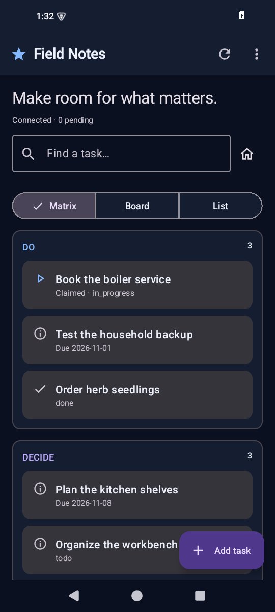
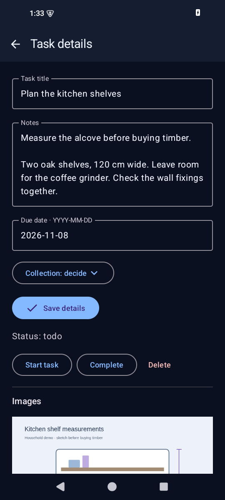
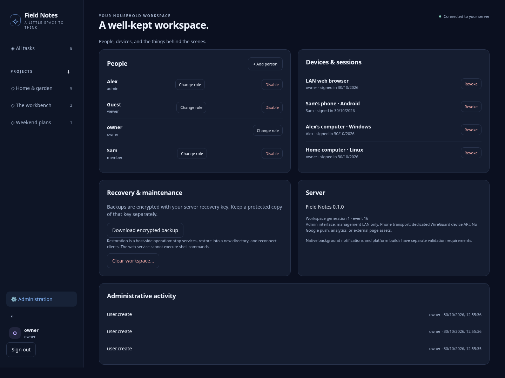

# Field Notes

A private household workspace for tasks, projects, notes, comments and images.
Original ink/slate styling inspired by Talaris's quiet, project-focused layout.
Home Linux server, app-contained WireGuard Android client, LAN-only administration.

**Development release 0.1.0.** The Android app now uses **Kotlin Multiplatform and
Compose**, replacing Flutter. A signed, sideloadable arm64 debug APK is built at
`dist/android/field-notes-0.1.0-android-arm64-debug.apk`, with checksum and signer
report. The Rust server and web interface are retained. See the current
[validation record](docs/VALIDATION.md) for tested behavior and practical limits.

## Screenshots and walkthrough

[See the complete Android, browser, and server management walkthrough](docs/WALKTHROUGH.md).
The Android app uses sample data and a test connection for these captures.
Browser images come from a disposable Rust server.

| Android app | Task details |
| --- | --- |
| <a href="docs/screenshots/android/03-matrix.png"></a> | <a href="docs/screenshots/android/08-task-notes.png"></a> |



## Features

- Projects, matrix/board/list task views, notes, comments, due dates, and images.
- Server-arbitrated task claims, revisions, replay-safe retries, deletion/reset
  fences, encrypted offline commands, provisional state and retained conflicts.
- Android Keystore-backed local encryption, atomic persistence, secure image
  cache scoped by server/user, device-credential UI lock and screenshot protection.
- Optional Google-free background catch-up and local due-date reminders using
  Android's scheduler. These are best-effort, not instant push or exact alarms.
- Server owner/admin/member/viewer roles, session revocation, audited overrides,
  reauthentication, workspace clearing, encrypted backup and host restore.
- No FCM, Play services, analytics, runtime CDN, OS VPN service or system routes.

The server and authorized administrators can decrypt household content, as
requested. This is not end-to-end encryption excluding the server. Protect the
host master key and disk; keep a protected recovery-key copy separately.

## Install the phone app

Copy the arm64 APK from `dist/android/` onto your GrapheneOS phone, verify its
SHA-256 and signing-certificate fingerprint, then open it and temporarily allow
installation from that source. This artifact uses a **development signer** kept
in the development tool cache; retain that key for in-place updates. A separately
configured operator key is required for signed release builds.

Open Field Notes, copy its public key, approve the peer on your home server, paste
the public connection JSON from the trusted LAN administrator, and sign in.
[Installation and pairing instructions](docs/RUNNING.md) include the server and
root-only peer helper. Production peer/QR enrollment is still manual.

## Build and test

```sh
bash scripts/setup/cloud.sh --android
source scripts/dev-env.sh
bash scripts/check.sh
bash scripts/android.sh hostTest lintDebug
bash scripts/build/android.sh debug
bash scripts/build/server.sh
```

Kotlin 2.1.21, Compose 1.8.2, AGP 8.10.1 and Gradle 8.11.1 are pinned. The Gradle
wrapper verifies the official distribution checksum. Dependencies are locked.
The SDK, NDK, JDK, Rust and Go caches are outside the checkout. APK builds do not
need the previously blocked Flutter downloads or additional network domains.

The server bundle and checksums are under `dist/server/`. iOS and native desktop
packages are deferred; common Kotlin UI/domain code provides a possible future
iOS path, with platform integration still required. No Apple build is needed now.

## Deployment and organization

Your topology is one home WireGuard hub with a forwarded UDP endpoint and distinct
client peers. The Android app creates its own userspace network stack; an existing
system VPN can still route/filter its outer UDP traffic. Only the device API is
admitted from peers. Web administration stays on the trusted LAN.

- `apps/mobile/`: Kotlin shared domain/UI, Android adapters, tests and Gradle build.
- `apps/server/src/`: Rust storage, crypto, HTTP, auth, commands and administration.
- `apps/admin/`: bundled LAN web interface for Linux/Windows browsers.
- `native/`: Go WireGuard/HTTPS stack, C ABI and Android JNI bridge.
- `deploy/`, `scripts/`, `tests/`: Linux configuration, builds, checks and fixtures.

[Run/install/recover](docs/RUNNING.md) · [Validation](docs/VALIDATION.md) ·
[Network](docs/NETWORK.md) · [Sync](docs/SYNC.md) · [Security](docs/SECURITY.md) ·
[Architecture](docs/ARCHITECTURE.md) · [Android decision](docs/adr/0002-android-kotlin-multiplatform.md)

This remains a development implementation. Physical GrapheneOS/VPN coexistence,
home routing and independent security review are separate checks. Household-wide
roles are implemented; per-project ACLs, QR enrollment, automatic upgrades, and
scheduled server backups remain future work. Earlier design documents describe
the target system; the validation record describes what exists now.
