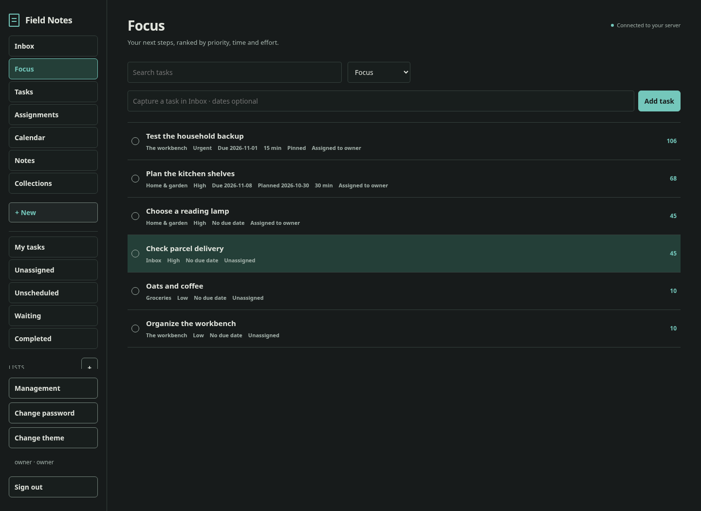

# Field Notes

A self-hosted household planner: Inbox, lists, projects, standalone notes, comments,
images, optional dates, priorities and a private calendar. Compact charcoal/paper, teal accents, clean rows.
Home Linux server, Android app, and a LAN website for Linux/Windows browsers.

**Development version 0.3.3.** Rust serves HTTPS directly. **No Caddy, reverse
proxy or load balancer.** Android uses Kotlin Multiplatform/Compose with an
app-contained WireGuard stack, without taking Android's VPN slot or using Google
services. iOS/native desktop packages are deferred.

[Installation](docs/RUNNING.md) · [Uninstall](docs/UNINSTALL.md) · [Phone enrollment](docs/ENROLLMENT.md) ·
[Updates without re-pairing](docs/UPDATES.md) · [Android download](docs/ANDROID-DOWNLOADS.md) · [Bungee review](docs/BUNGEE-PAIRING-REVIEW.md) ·
[Screenshot walkthrough](docs/WALKTHROUGH.md) · [Validation](docs/VALIDATION.md)



## Planner and administration

- Capture tasks in Inbox without creating a project. Lists hold shopping, routines
  and checklists; Projects group an outcome. Move tasks between either or Inbox.
  Standalone Notes hold shared reference material with pinning and search.
  Unscheduled, Waiting and Completed views surface different kinds of work.
- Tasks and Assignments are explicit views, with My tasks and Unassigned filters.
  Planned responsibility is separate from the exclusive working claim. Handoffs
  require releasing active work; unavailable people cannot receive new assignments.
- Focus ranks tasks using priority, optional due date, planned day, waiting time
  and estimate. Pins come first; blocked/completed/other-claimed/future-planned
  tasks stay out of Focus. Each task explains its score. No artificial due dates.
- Calendar shows task due/planned days and all-day/timed events. Dates and time
  zones have distinct semantics; no Google or OS Calendar integration.
- Task notes, image attachments and comments; encrypted offline edits/outbox,
  replay-safe retries, server-arbitrated claims and retained conflicts.
- QR enrollment: select an account, scan on home Wi-Fi, enter the phone's code
  on the server, then wait for peer installation and tunnel activation. Private
  keys stay on phones. Revocation stops content access immediately and tracks
  confirmed peer removal separately.
- LAN management: users/roles, devices/sessions, audited claim overrides, backup,
  workspace clearing and server state. Owner/admin/member/viewer household roles.
  Installation asks you to choose the initial owner password. Every account uses
  its own salted Argon2id hash; users can change their password in the website,
  and authorized administrators can reset other users' passwords in People.
  Routine password changes preserve phone pairings; signing phones out is explicit.
- In-app APK updates follow the paired server, with bounded private downloads,
  full signature/package/hash checks and Android install confirmation. Upgrades
  keep phone keys and queued edits. Linux upgrades retain the hub/CA/peers and
  include scoped backup, readiness and rollback. [Update guide](docs/UPDATES.md).
- Actual Android Upcoming and Focus home-screen widgets, redacted by default.
  Default-on private background connection and cached task/calendar alerts without
  Google services. [GrapheneOS profile/sound setup](docs/ANDROID-DELIVERY.md),
  delayed profile test and revoke/uninstall flow; Android scheduling limits apply.
- Keystore/AES-GCM local vault, device credential UI lock, screenshot protection,
  scoped image picker, offline QR scanner, no analytics/runtime CDN/FCM/Play services.

The server can decrypt content, as requested. Protect its master key, disk and
host configuration. This is not end-to-end encryption excluding the server.
[Security](docs/SECURITY.md) describes exact boundaries.

## Install or build

The server bundle includes the matching signed ARM64 APK. Open the LAN website
on your phone and choose **Download APK** on Sign in or in Management; checksum
and signer links are beside it. [Download and release details](docs/ANDROID-DOWNLOADS.md).

The signed arm64 development APK, checksum and signer report are also under
`dist/android/field-notes-0.3.3-android-arm64-debug.apk`. Copy it to your phone,
verify hash/signer, and open it to sideload. Preserve the development signer for
in-place updates. Operator release builds require your separately protected key.

```sh
bash scripts/setup/cloud.sh --android
source scripts/dev-env.sh
bash scripts/check.sh
bash scripts/build/android.sh debug
bash scripts/build/server.sh
```

On your Debian/Ubuntu x86_64 server, after cloning the repository, run as root:

```sh
bash scripts/install-server.sh
```

The guided installer asks for LAN details, optional remote endpoint and private
overlay, and both ports (no suggested values). Review the plan and type
`INSTALL`. It then prepares the pinned toolchains, builds the matching
signed development Android APK and server/offline Docker images, and installs
the stack. Docker Engine/Compose and basic build prerequisites must already
work on the host. A no-write preview uses
`bash scripts/install-server.sh --plan`; for a prebuilt verified server
bundle use `bash scripts/install-server.sh --apply`.
Never commit operator signing keys or place installation secrets in Git.

Forward the **WireGuard UDP port you choose** to the Linux server.
See the [router forwarding instructions](docs/RUNNING.md#fresh-home-server).
The installer requires **explicit management HTTPS and WireGuard UDP ports**:
enter both in the interactive prompts, or supply `--web-port` and `--udp-port`.
There are no suggested or automatic port numbers.
LAN management uses direct TLS on your chosen port, and the isolated
WireGuard notes endpoint is 8443. The bundle includes offline Docker images:
a nonroot, read-only app and a separate WireGuard gateway. New outbound traffic,
including DNS, is blocked; replies to allowed incoming connections work. Local
certificate renewal and constrained host peer provisioning need no cloud service.
Docker Engine/Compose and kernel WireGuard support are prerequisites. No manual
phone peer JSON is needed. See [container boundaries](docs/CONTAINERS.md) and [RUNNING.md](docs/RUNNING.md)
for trust, enrollment, exact artifact paths and recovery.

The installed `/opt/field-notes/uninstall-server.sh` previews removal by default.
`--apply` preserves data and recovery keys; `--apply --purge` explicitly deletes
them. It leaves Bungee, Docker and shared packages alone. [Removal guide](docs/UNINSTALL.md).

## Organization and evidence

- `apps/server/src/store/`: transactional auth, commands/planning, enrollment, admin and backup.
- `apps/admin/`: bundled planner/calendar/management, no external page dependencies.
- `apps/mobile/`: shared Kotlin domain/UI, Android adapters/widget/scanner and tests.
- `native/`: endpoint-only WireGuard/HTTPS, scoped LAN enrollment, C/JNI bridge.
- `scripts/`, `deploy/`, `tests/`: reproducible builds/install, constrained helpers,
  cross-language planning fixtures and real-process/transport checks.

[Architecture](docs/ARCHITECTURE.md) · [Network](docs/NETWORK.md) ·
[Sync](docs/SYNC.md) · [Planner research and scoring](docs/PLANNER-RESEARCH.md) ·
[Household workflow review](docs/HOUSEHOLD-WORKFLOWS.md)

Screenshots use synthetic data. Browser captures run against the real Rust server;
Android captures render actual Compose/RemoteViews using a test-only connection.
Physical GrapheneOS/VPN coexistence, home routing/isolation and independent review
remain separate deployment checks. Unattended installation and per-project ACLs
remain future work. Check the validation record before treating any feature as verified
on your own hardware.
