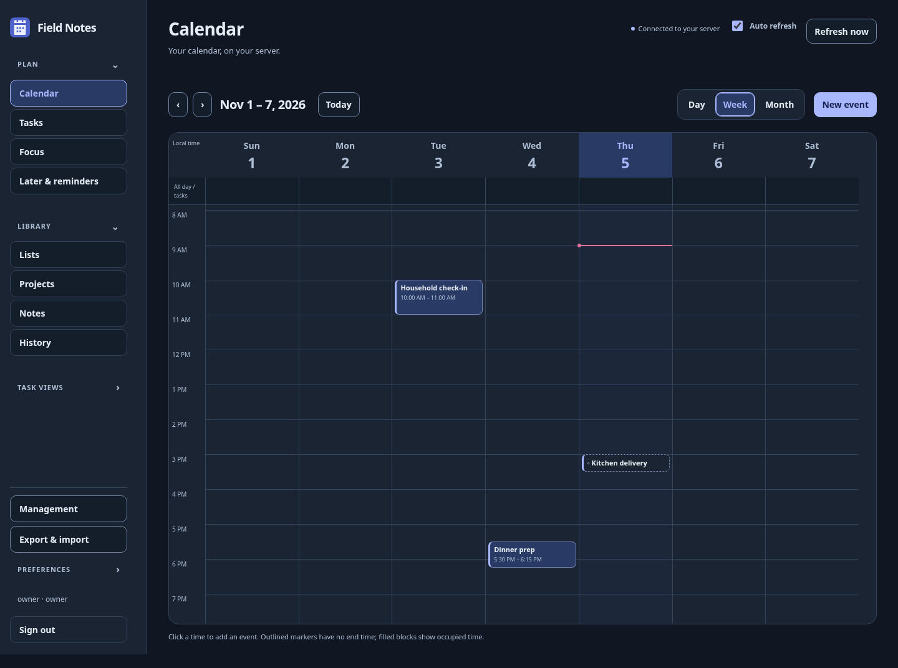

# Field Notes

[**Download latest Android APK (ARM64)**](https://github.com/argentumseven/field-notes/releases/latest/download/field-notes.apk) · [Release notes and checksums](https://github.com/argentumseven/field-notes/releases/latest)

Standard server installs and GitHub downloads use the same public signing certificate
and the exact same APK. Existing custom-signed phones retain their original signer.

A self-hosted household planner: Inbox, lists, projects, standalone notes, comments,
images, optional dates, priorities and a private calendar. Calendar first, with
grouped navigation, clear controls and matching light/dark themes.
Home Linux server, Android app, and a LAN website for Linux/Windows browsers.

**Development version 0.8.1.** Rust serves HTTPS directly. **No Caddy, reverse
proxy or load balancer.** Android uses Kotlin Multiplatform/Compose with an
app-contained WireGuard stack, without taking Android's VPN slot or using Google
services. iOS/native desktop packages are deferred.

[Debian commands](docs/DEBIAN-INSTALL.md) · [Installation](docs/RUNNING.md) · [Uninstall](docs/UNINSTALL.md) · [Phone enrollment](docs/ENROLLMENT.md) ·
[Updates without re-pairing](docs/UPDATES.md) · [Android download](docs/ANDROID-DOWNLOADS.md) · [Troubleshooting](docs/TROUBLESHOOTING.md) ·
[Calendar and home-screen month widget](docs/CALENDAR.md) · [Reminders and sound](docs/REMINDERS.md) · [List types and fields](docs/LISTS.md) · [Offline work and reconnect](docs/OFFLINE.md) ·
[Household planning](docs/PLANNER-0.6.md) · [History & restore](docs/HISTORY.md) · [Planner comparison](docs/PLANNER-COMPARISON.md) · [Export & import](docs/CONTENT-FILES.md) · [Screenshot walkthrough](docs/WALKTHROUGH.md) · [Validation](docs/VALIDATION.md)



## Planner and administration

- Capture tasks in Inbox without creating a project. Lists hold shopping, routines
  and checklists; Projects group an outcome. Move tasks between either or Inbox.
  Standalone Notes hold shared reference material with pinning and search.
  Unscheduled, Waiting and Completed views surface different kinds of work.
- Tasks and Assignments are explicit views, with My tasks and Unassigned filters.
  Planned responsibility is separate from the exclusive working claim. Handoffs
  require releasing active work; unavailable people cannot receive new assignments.
- Focus ranks tasks using priority, optional due date, planned day, waiting time
  and estimate. Pins come first; blocked/completed/other-claimed/future-planned
  tasks stay out of Focus. Each task explains its score. No artificial due dates.
- Sunday-first calendars open first, with aligned day/week time blocks, a continuous month grid and local clock
  controls. End times are optional; start-only markers do not occupy time.
  Multiple reminders support separate importance, eight sounds and relative volume.
  Choose recipients per person or everyone, and optionally ring a longer alarm
  with temporary alarm-volume raising and restoration on each consenting phone.
  Repeat events on selected weekdays, alternate days/weeks, custom intervals or individual dates, with skipped dates and yearly intervals. Repeat reminders within a chosen daily/weekly window, even without a due date. New items default to Everyone; existing personal choices are preserved.
- Lists have grocery, online shopping, general and custom presets. Select fields
  such as quantity, store, link, optional price, images and dates. Store groups and filters keep groceries in their own subview. Rolling lists let you
  clear checked items or reuse their original records while retaining unchecked ones. Image previews use attached
  images only; there are no retailer requests. Rows show creator/activity times.
- Later & reminders keeps undated ideas and optional follow-up alerts outside occupied calendar time. Searches include titles and content, with category/person/status filters and useful sort fields.
- Granular shared-addition notices name the person, item and list. Each list can mute additions and scheduled item reminders separately.
- Encrypted content export/import works on phone and web, preserves offline changes and images, skips duplicates and retains conflicting alternatives without overwriting current work.
- Indexed item versions and named content checkpoints support reviewed backward/forward restores, including deleted items and attachments, with configurable age, count and storage limits. Accounts and pairings stay current. [Recovery guide](docs/RECOVERY.md).
- History on web and phone lists each item once, with full saved-state inspection and restoration. It shows who added, changed or removed content, with server timestamps, Previous/Now field details, search and filters. Removed items stay identifiable; recent phone history is cached offline. [History and retention](docs/HISTORY.md).
- Task notes, image attachments and comments; encrypted offline edits/outbox,
  replay-safe retries, server-arbitrated claims and retained conflicts.
- QR enrollment: bind the phone public key on your PC, scan, enter the phone's code
  on the server, then wait for peer installation and tunnel activation. Private
  keys stay on phones. Revocation stops content access immediately and tracks
  confirmed peer removal separately.
- LAN management: users/roles, devices/sessions, audited claim overrides, backup,
  workspace clearing and server state. Owner/admin/member/viewer household roles.
  Installation asks you to choose the initial owner password. Every account uses
  its own salted Argon2id hash; users can change their password in the website,
  and authorized administrators can reset other users' passwords in People.
  Routine password changes preserve phone pairings; signing phones out is explicit.
- In-app APK updates follow the paired server, with bounded private downloads,
  full signature/package/hash checks and Android install confirmation. Upgrades
  keep phone keys and queued edits. Linux upgrades retain the hub/CA/peers and
  include scoped backup, readiness and rollback. [Update guide](docs/UPDATES.md).
- Actual Android Week, Calendar, Upcoming and Focus home-screen widgets. Week
  shows seven days with agenda rows and occupied-time bars. Schedule titles and
  detailed notifications default on while unlocked; lock-screen disclosure has
  separate switches. Existing visibility preferences are preserved.
  Default-on private background connection and cached task/calendar alerts without
  Google services. [GrapheneOS profile/sound setup](docs/ANDROID-DELIVERY.md),
  delayed profile test and revoke/uninstall flow; Android scheduling limits apply.
- Keystore/AES-GCM local vault, optional device credential UI lock, screenshot protection,
  scoped image picker, offline QR scanner, no analytics/runtime CDN/FCM/Play services.

The server can decrypt content, as requested. Protect its master key, disk and
host configuration. This is not end-to-end encryption excluding the server.
[Security](docs/SECURITY.md) describes exact boundaries.

## Install or build

**GitHub Android APK:** [Download the latest verified APK](https://github.com/argentumseven/field-notes/releases/latest/download/field-notes.apk), or browse [all release assets](https://github.com/argentumseven/field-notes/releases).

The server bundle includes the matching signed ARM64 APK. Download it on your
management PC from **Download APK** on Sign in or in Management, then transfer
it to the phone. The phone does not need management access. Paired phones fetch
updates through the private notes tunnel. [Download and release details](docs/ANDROID-DOWNLOADS.md).

Server builds download the APK from the matching versioned GitHub release,
verify its actual signature against the pinned public certificate, and preserve
its published checksum and source metadata. They do not generate signing keys.
Custom Android builds are an explicit developer/operator choice; keep their
original signing key for in-place updates.

```sh
bash scripts/setup/cloud.sh --server
source scripts/dev-env.sh
bash scripts/build/server.sh
```

On your Debian/Ubuntu x86_64 server, after cloning the repository, run as root:

```sh
bash scripts/install-server.sh
```

The guided installer asks for LAN details, optional remote endpoint and private
overlay, and both ports (no suggested values). Review the plan and type
`INSTALL`. It then prepares the pinned toolchains, verifies the matching
public GitHub APK, builds the server/offline Docker images, and installs
the stack. Docker Engine/Compose must already work on the host. Missing Debian/Ubuntu
build packages are installed automatically after plan confirmation. A no-write preview uses
`bash scripts/install-server.sh --plan`; for a prebuilt verified server
bundle use `bash scripts/install-server.sh --apply`.
Never commit operator signing keys or place installation secrets in Git.

Forward the **WireGuard UDP port you choose** to the Linux server.
See the [router forwarding instructions](docs/RUNNING.md#fresh-home-server).
The installer requires **explicit management HTTPS and WireGuard UDP ports**:
enter both in the interactive prompts, or supply `--web-port` and `--udp-port`.
There are no suggested or automatic port numbers.
LAN management uses direct TLS on your chosen port, and the isolated
WireGuard notes endpoint is 8443. The bundle includes offline Docker images:
a nonroot, read-only app and a separate WireGuard gateway. New outbound traffic,
including DNS, is blocked; replies to allowed incoming connections work. Local
certificate renewal and constrained host peer provisioning need no cloud service.
Docker Engine/Compose and kernel WireGuard support are prerequisites. No manual
phone peer JSON is needed. See [container boundaries](docs/CONTAINERS.md) and [RUNNING.md](docs/RUNNING.md)
for trust, enrollment, exact artifact paths and recovery.

The installed `/opt/field-notes/uninstall-server.sh` previews removal by default.
`--apply` preserves data and recovery keys; `--apply --purge` explicitly deletes
them. It leaves Docker and shared packages alone. [Removal guide](docs/UNINSTALL.md).

## Organization and evidence

- `apps/server/src/store/`: transactional auth, commands/planning, enrollment, admin and backup.
- `apps/admin/`: bundled planner/calendar/management, no external page dependencies.
- `apps/mobile/`: shared Kotlin domain/UI, Android adapters/widget/scanner and tests.
- `native/`: endpoint-only WireGuard/HTTPS, key-bound tunnel enrollment, C/JNI bridge.
- `scripts/`, `deploy/`, `tests/`: reproducible builds/install, constrained helpers,
  cross-language planning fixtures and real-process/transport checks.

[Architecture](docs/ARCHITECTURE.md) · [Network](docs/NETWORK.md) ·
[Sync](docs/SYNC.md) · [Planner research and scoring](docs/PLANNER-RESEARCH.md) ·
[Household workflow review](docs/HOUSEHOLD-WORKFLOWS.md)

Screenshots use synthetic data. Browser captures run against the real Rust server;
Android captures render actual Compose/RemoteViews using a test-only connection.
Physical GrapheneOS/VPN coexistence, home routing/isolation and independent review
remain separate deployment checks. Unattended installation and per-project ACLs
remain future work. Check the validation record before treating any feature as verified
on your own hardware.
