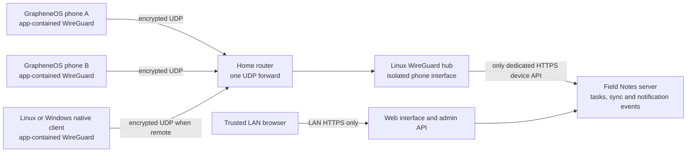

# Selected home network contract

Status: design only. The user will provide home-router WireGuard UDP forwarding.
No public web listener or relay is selected. Encryption is server-readable.

## Topology

Each device is a distinct peer with its own private key and assigned inner
address. Use one hub UDP listener, not a separate home-router forward for every
phone. The phones initiate handshakes outbound toward it; NAT mappings carry
replies. Persistent keepalive, when needed, affects battery use and does not
keep the app executing after the OS suspends it.

The diagram shows logical boundaries, not a requirement for separate application
processes. The server may expose separate listeners from one process while
preserving interface/firewall/authorization separation. If a separate WireGuard
gateway container is used, keep its NET_ADMIN privileges outside the content
service. Avoid publishing inner device ports on the host WAN by accident.

## Required access matrix

| Source | Destination | Policy |
| --- | --- | --- |
| Internet | Chosen WireGuard UDP endpoint | Allow encrypted peer traffic only; no public HTTP/admin |
| Enrolled phone/client peer | Dedicated inner HTTPS device API | Allow with both peer and application authentication |
| Phone/client interface | LAN web/admin API, even addressed by its LAN IP | Deny on the server, regardless of client AllowedIPs |
| Phone/client interface | Host SSH, Docker, DB, or other listening services | Deny |
| Phone/client interface | Another peer | Deny forwarding |
| Phone/client interface | Home LAN or general Internet | Deny forwarding; not a general-purpose VPN |
| Trusted management LAN | HTTPS web/admin listener | Allow network access; authentication and role checks still apply |
| Untrusted/guest LAN | HTTPS web/admin listener | Deny unless explicitly included by the operator |

Match ingress interface as well as source/destination addressing. Apply deny
rules before broad established/related allowances when changing isolation, so
an existing unauthorized connection is not grandfathered in. Validate both
IPv4 and IPv6. Binding admin to a LAN IP alone does not prevent a peer from
addressing that LAN IP through the tunnel; the server must enforce the matrix.

Where a reverse proxy serves LAN web/admin and device HTTPS, use independent
listeners/routes and ensure admin handlers cannot be reached through the device
listener. Client-controlled Host or forwarded headers must not select a more
privileged route or override the authenticated peer identity.

## Pairing and recovery

Install the app before pairing. The phone generates its own peer key locally.
From the trusted LAN dashboard, approve its public key and role and issue a
short-lived single-use invitation. The invitation supplies the chosen endpoint,
server public key, assigned address, permitted inner API, and authenticated TLS
trust material. It must bind to the device that requested it. Keep invitations
and any optional preshared secret out of logs and cloud-synced screenshots.

Initial enrollment needs a narrowly limited way to complete pairing before the
device has a fully active application session. A pending WireGuard peer may
reach enrollment only, not read content. Commit peer activation and application
identity binding consistently; interrupted enrollment can retry safely. Expired
pending peers are removed. The native app refuses arbitrary destinations and
redirects, but the server still independently enforces isolation.

Revoke both the application session/device and the WireGuard peer. A DB failure
or peer-file refresh failure must not be presented as completed revocation.
Reject application requests immediately at the authorization layer while peer
removal retries. On loss of local keys, re-pair as a new device rather than
quietly overwriting an existing identity. Certificates and server endpoint
changes need authenticated rotation and recovery procedures.

## Compatibility and failure behavior

- Choose a configurable subnet that does not overlap Bungee, the home LAN, or
  expected system VPNs. Use distinct key stores and identifiers for each app.
- A system VPN may route or filter the outer UDP packets. VPN lockdown and
  GrapheneOS network-permission settings must remain effective. No hidden
  socket protection, route changes, default route, or DNS takeover.
- If the current network blocks UDP, show offline/pending status. Do not silently
  fall back to public plaintext HTTP, a public relay, or bypass the current VPN.
- Verify public IPv4 or routed IPv6 reachability. CGNAT, double NAT, dynamic IP,
  firewall changes, and ISP restrictions require an explicit fix; WireGuard does
  not supply rendezvous/NAT traversal by itself. Hairpin NAT may fail at home;
  support a trusted configured LAN endpoint with the same authenticated peer
  identity rather than guessing arbitrary addresses.
- DDNS, if selected, exposes endpoint lookup metadata and depends on DNS through
  the phone's existing network policy. No need to modify system DNS. Do not
  confuse privacy of task content with hiding all endpoint metadata.
- Use bounded connection/reconnect work with jitter, cancellation, streaming,
  upload resumability, and tested MTU behavior. A transport outage must not lose
  an offline draft or create a second task when a retry succeeds.
- Desktop clients need native stack builds for their OS. Web browsers use LAN
  HTTPS and cannot automatically enter the app-contained WireGuard network.
- iOS can use an in-process transport while running, but this does not exempt it
  from suspension or provide background push without platform services.

## Notification consequences

An app-contained tunnel belongs to one process/library. A separate ntfy or
UnifiedPush distributor cannot connect to the server's inner IP through it.
Sharing the same WireGuard peer credentials with another app is not the fix.

Use local reminders and the app's authenticated durable event connection first.
Test an explicitly enabled, user-visible persistent connection on GrapheneOS
before claiming fast background remote notifications. Check the supported Android
foreground-service type and lifecycle on each supported OS version; don't
mislabel a permanently running sync task to avoid time limits. Background
polling/OS scheduling is best-effort and cannot meet an exact-latency guarantee.

If independent UnifiedPush is desired later, choose either a supported embedded
distributor using the same transport, or a separately reachable self-hosted push
endpoint. The latter needs additional routing/exposure and is a new decision,
not part of the current one-UDP-port deployment. APNs is a separate optional iOS
decision; it is never implied by Android support.
