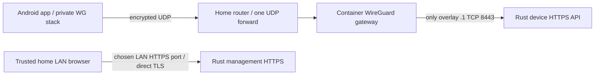

# Home network contract

The Linux server serves HTTPS directly. No Caddy, reverse proxy, load balancer,
public web endpoint or relay is installed. Encryption is server-readable.

Each phone has its own local private key, server-generated PSK and inner /32
address. One hub UDP listener serves all phones. The phone uses wireguard-go and
gVisor inside its app, with no Android VpnService, OS interface, routes, socket
protection, system DNS changes or default route. Its ordinary outer UDP sockets
remain subject to the existing VPN, lockdown, GrapheneOS network permission and
network filters. Multiple app-contained tunnels do not consume the system VPN
slot; real coexistence still needs physical testing.

The app and gateway share a private Docker network namespace. Namespace-local
nftables enforces ingress and denies new outbound connections, including DNS.
Only the gateway has NET_ADMIN; the app has no capabilities or Docker socket.
Established replies remain allowed. See [CONTAINERS.md](CONTAINERS.md).

## Enforcement

| Source | Allowed destination |
| --- | --- |
| Internet | The selected WireGuard UDP port only (operator-selected) |
| Enrolled phone peer | Exactly overlay server `.1`, TCP 8443, device routes and device-bound authentication |
| Phone interface | No LAN/admin, SSH, other host services, peer-to-peer, IPv6 or forwarded Internet traffic |
| Selected management LAN CIDR | Management IP:chosen HTTPS port (operator-selected); login, roles, CSRF and recent admin reauthentication still apply |

The installer generates nftables input/forward isolation before starting
WireGuard. Peer traffic to every other host port/address is dropped, including
established flows and IPv6. Client AllowedIPs and a fixed inner HTTPS dial target
also limit intent, but the server firewall is the security boundary against a
modified client. Device routes exclude management handlers. Authorization checks
the actual TCP source; `X-Forwarded-For`, `Host` and similar headers confer no
identity. Never put a forwarding proxy in front of the device listener.

Existing host firewall rules may still block the chosen UDP or management port;
the installer does not weaken unrelated firewall policy. Review those rules on
your server and verify the access matrix from a separate test peer.

## Reachability

Supply `--endpoint home.example.net` to enroll your reachable DDNS/IP endpoint
using the WireGuard UDP port chosen during installation. An explicit external
`:port` is also supported; the plan prints any external-to-internal NAT mapping.
The installer adds a trusted LAN UDP alternative with the same WireGuard peer,
PSK, inner destination and TLS CA. Native requests can retry an identical body
through the alternative after a connection failure. HTTP authorization failures
do not trigger this retry. There is no plaintext, public HTTP or relay fallback.
Without `--endpoint`, installation is LAN-only and the plan says so.

Forward only that UDP port to the Linux host. Both management HTTPS and
WireGuard UDP ports are chosen explicitly during installation; the terminal
installer prompts for each missing choice. No port is suggested or derived
from another service. Enter both ports interactively or use `--web-port`
and `--udp-port` explicitly. Only the selected UDP port is a router-forwarding
candidate. See the [router forwarding rule](RUNNING.md#fresh-home-server).
CGNAT, double NAT, ISP UDP filtering,
captive portals, dynamic addresses and an active VPN can prevent reachability.
A WireGuard hub supplies neither rendezvous nor automatic NAT traversal. DNS for
DDNS uses the OS network policy and discloses endpoint lookup metadata. Choose a
nonoverlapping /24 distinct from Bungee, the LAN and your other VPN routes.

The management listener has a private LAN address and explicit source CIDR ACL.
A browser cannot borrow the Android app's private stack. Linux/Windows browsers
use LAN HTTPS; remote native desktop and iOS clients are deferred.

## Trust and lifecycle

The installer makes a local P-256 CA and a 365-day server certificate, with LAN
IP/hostname and overlay IP SANs. The CA private key is root-only. The nonroot app
can read only the leaf key and public CA. Trust the public CA on administrator
computers after checking its fingerprint directly on the host. The phone pins
the QR-supplied CA after explicit trusted-source confirmation, then verifies
certificate chain, name, expiry and TLS 1.3 on both enrollment and tunnel APIs.
A malicious QR from an untrusted source can enroll a malicious server; the human
trust step is essential.

A daily root timer renews the leaf when fewer than 30 days remain, without
network access; Rust reloads a valid matching certificate/key within 60 seconds.
The CA stays the same. Replacing the CA or server WireGuard identity requires
reviewed re-enrollment; changing only the outer endpoint preserves identity.
See [ENROLLMENT.md](ENROLLMENT.md).

Foreground synchronization, local reminders and scheduled catch-up need no
Google services. Instant background push is not implemented. An independent
ntfy/UnifiedPush distributor cannot access another app's private network stack.
